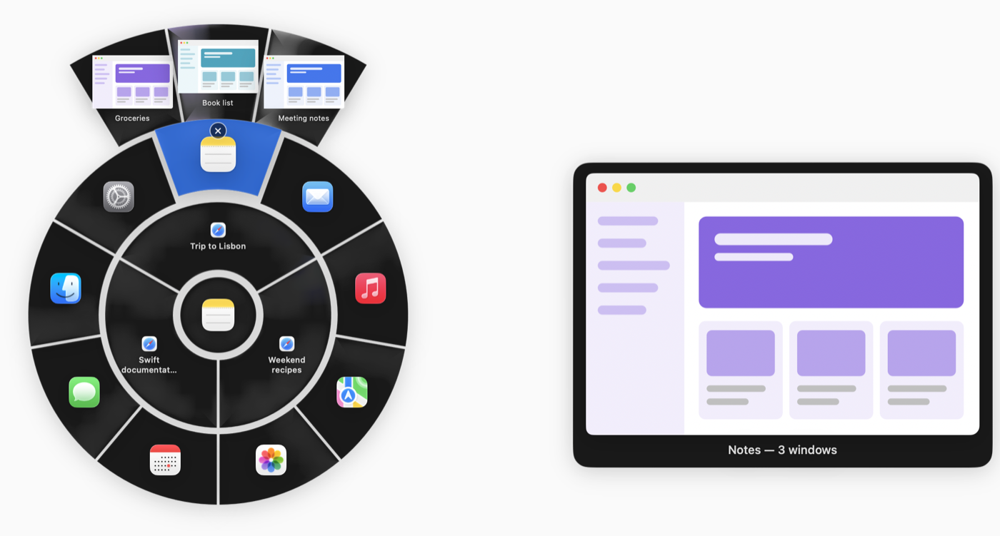
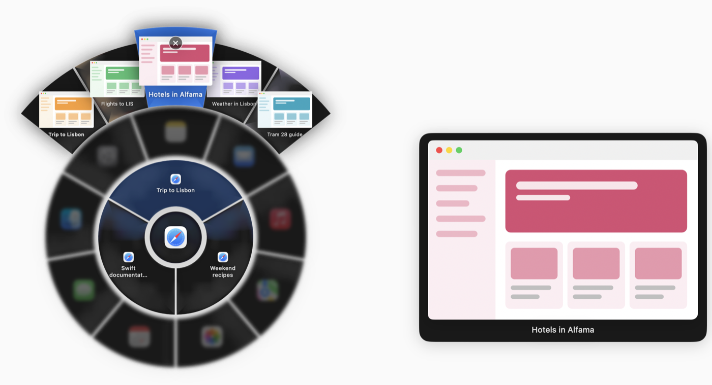

# Radial Switcher

A radial window switcher for macOS (this page), Windows (see [`windows/`](windows/README.md)) and Linux/X11
(see [`linux/`](linux/README.md)). Hold **⌥Space** and a ring opens around the cursor: the windows of
the app you're in on the inside, every other open app on the outside. Aim with the mouse (or press Tab),
let go, and that window comes to the front — including a specific window or browser tab of another app.

<p align="center">
  
</p>

<p align="center">
  
</p>

## Features

- **Two rings**: inner ring = windows of the frontmost app, outer ring = all other running apps (apps
  without windows too; picking one reopens it).
- **Window and tab arcs**: rest on an app in the outer ring and its windows fan out behind it; go on to a
  window and its tabs fan out behind that. For the frontmost app, pause on one of its windows and its tabs
  pop up over the faded app ring.
- **Previews**: every item shows a thumbnail; the selected window streams **live** (video keeps playing)
  in a large preview card. Minimized windows and background tabs show their last snapshot.
- **Angle-based aiming**: the segment is chosen by the direction of the cursor, not by hitting an icon
  exactly; a small dead zone in the middle selects nothing.
- **Close button**: the item you point at shows an × in its corner. Click it to quit the app, close the
  window or close the tab; the ring stays open and updates.
- **Keyboard**: Tab / Shift+Tab walk through windows and apps, Return confirms, Esc cancels.
- **Liquid Glass** look on macOS 26 (translucent material on older versions), hover magnification and
  smooth animations.
- Opens centered on the cursor; near screen edges the outer arcs rotate to stay fully on screen.

## Requirements

- macOS 14 Sonoma or later (developed and tested on macOS 26).
- Swift 6 toolchain: Xcode 16+ or the Command Line Tools (`xcode-select --install`).

## Build and install

```bash
git clone https://github.com/panagiwtisiwannidis/radial-window-switcher.git
cd radial-window-switcher
./scripts/build-app.sh --install
```

This builds a release binary, packages it as `RadialSwitcher.app`, signs it, copies it to
`/Applications` and launches it. Without `--install` the app is only built into `build/RadialSwitcher.app`.

**Signing**: the script uses the first *Apple Development* or *Developer ID Application* certificate in
your keychain, or the one named in `SIGN_IDENTITY`:

```bash
SIGN_IDENTITY="Apple Development: Your Name (TEAMID)" ./scripts/build-app.sh --install
```

With no certificate it signs ad-hoc. That works, but macOS then forgets the app's permissions on every
rebuild, so you have to grant them again.

## First launch

Radial Switcher lives in the menu bar (no Dock icon). On first launch it asks for two permissions:

| Permission | Why |
|---|---|
| **Accessibility** | List windows and tabs, and bring the chosen one to the front. |
| **Screen & System Audio Recording** | Window previews. Nothing leaves your Mac. |

Use **Open Settings** next to each one and switch Radial Switcher on in System Settings → Privacy &
Security. After granting Screen Recording, click **Restart** (macOS only applies it to a fresh launch).
You can reopen this window any time from the menu bar icon → **Permissions…**.

## Usage

| Action | How |
|---|---|
| Open the ring | Hold **⌥Space** |
| Pick a window / app | Move the cursor toward it, then release ⌥Space (or click) |
| Another app's windows | Rest on the app in the outer ring, keep going outward onto the window arc |
| A tab of another app | Go from the window arc further out onto its tab arc |
| Tabs of the current app | Pause briefly on one of its windows in the inner ring |
| Close an app, window or tab | Point at it and click the **×** in its corner (an app quits; the ring stays open) |
| Keyboard | **Tab** / **Shift+Tab** to move, **Return** to open, **Esc** to cancel |
| Cancel | Esc, right-click, or click away from the ring |

If you release ⌥Space with nothing selected, the ring stays open: pick with a click, Tab + Return, or
dismiss with Esc. Only what's under the cursor (highlighted, shown in the preview card) is ever opened.

## Start at login

To have Radial Switcher start automatically whenever you log in to your Mac, click its menu bar icon
and choose **Open at Login** (a checkmark shows it's on; choose it again to turn it off). It then also
appears in System Settings → General → Login Items & Extensions, where it can be managed too.

Open at Login works best with the app in `/Applications` (where `--install` puts it).

## Quit

Menu bar icon → **Quit Radial Switcher**. To start it again, open **Radial Switcher** from Applications,
Spotlight or Launchpad.

## Development

```bash
swift build
swift run                                   # run from the terminal (permissions then go to your terminal app)
swift run RadialSwitcher list               # print all windows the switcher sees
swift run RadialSwitcher focus <windowID>   # bring one window to the front
swift run RadialSwitcher demo windows       # show the ring with sample apps and windows (also: tabs, apps)
```

The screenshots above come from the demo: run it, then capture just its window, which keeps the
transparent background (`screencapture -o -l <windowID> shot.png`; Esc closes the demo).

Only one copy can own ⌥Space at a time: quit the installed app before `swift run`.

To regenerate the app icon after editing `scripts/make-icon.swift`:

```bash
swift scripts/make-icon.swift /tmp/icon_1024.png
mkdir -p /tmp/AppIcon.iconset
for s in 16 32 128 256 512; do
  sips -z $s $s /tmp/icon_1024.png --out /tmp/AppIcon.iconset/icon_${s}x${s}.png
  sips -z $((s*2)) $((s*2)) /tmp/icon_1024.png --out /tmp/AppIcon.iconset/icon_${s}x${s}@2x.png
done
iconutil -c icns /tmp/AppIcon.iconset -o Support/AppIcon.icns
```

### Project layout

| Path | What |
|---|---|
| `Sources/RadialSwitcher/` | The app (Swift, AppKit + SwiftUI) |
| `Support/Info.plist`, `Support/AppIcon.icns` | App bundle metadata and icon |
| `scripts/build-app.sh` | Build, package, sign, install |
| `docs/screenshots/` | README screenshots (made with the demo, sample content only) |
| `windows/` | The Windows version (Rust) |
| `linux/` | The Linux/X11 version (Rust) |
| `core/` | Ring logic and drawing shared by Windows and Linux |

## Notes

- Window snapshots are cached in `~/Library/Caches/RadialSwitcher` so previews survive minimizing,
  tab switches and restarts. Entries for closed windows and tabs are deleted as soon as they're gone,
  and anything older than 3 days is removed.
- It uses a few private macOS APIs (to match accessibility windows to screen-capture windows and to
  focus a specific window), so it can't be distributed through the Mac App Store and could need updates
  for future macOS versions.
- Tabs are read through Accessibility: Safari and apps with native macOS tabs are supported; apps that
  don't expose their tabs that way show no tab arc.
- Windows on other Spaces are handled in code but haven't been tested much.

## Uninstall

Turn off **Open at Login** and quit from the menu bar icon, then:

```bash
rm -rf /Applications/RadialSwitcher.app ~/Library/Caches/RadialSwitcher
```

and remove Radial Switcher from System Settings → Privacy & Security → Accessibility and Screen & System
Audio Recording.

## Windows

The Windows version lives in [`windows/`](windows/README.md): Rust, hold **Alt+Space**, with the same
rings, window and tab arcs, live previews and a tray icon. Prebuilt executables come from the
**Windows build** GitHub Action.

## Linux

The Linux version lives in [`linux/`](linux/README.md): X11 sessions and wlroots-based Wayland compositors
(Hyprland, Sway, niri, river, …), hold **Alt+Space**, with window and browser-tab arcs, live previews (X11)
and a tray icon. Prebuilt binaries come from the **Linux build** GitHub Action, which also smoke-tests it on
a virtual X11 desktop and on a headless Sway.

The ring layout, selection logic and drawing shared by Windows and Linux live in [`core/`](core).

## Roadmap

- Wayland: window thumbnails and live previews; GNOME Shell extension and KWin script for GNOME/KDE.

## License

Copyright © 2026 Panagiotis Ioannidis. Released under the [MIT License](LICENSE).
Want to help? See [CONTRIBUTING.md](CONTRIBUTING.md).
