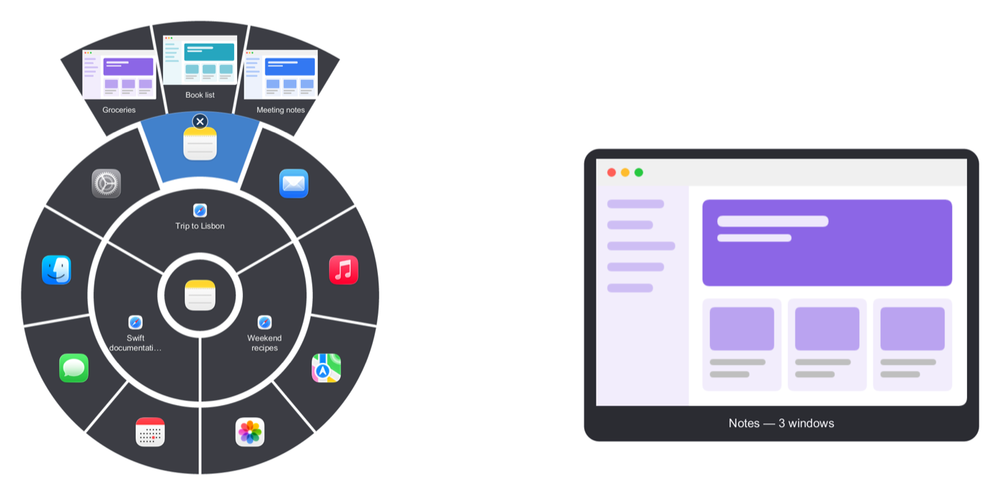
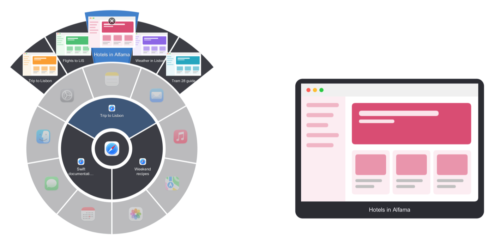

# Radial Switcher for Linux

The Linux version of Radial Switcher. Hold **Alt+Space** and a ring opens around the cursor: the windows
of the app you're in on the inside, every other app on the outside. Aim with the mouse (or press Tab),
let go, and that window comes to the front.

> **Status: early.** Built, linted and smoke-tested on CI: on a virtual X11 desktop (switching windows and
> Firefox tabs, closing with the ×) and on a headless Wayland compositor (Sway: switching windows with the
> mouse and keyboard, most-recent order, Esc). Not yet tried on a real desktop. Please report anything that
> doesn't work.

<p align="center">
  
</p>

<p align="center">
  
</p>

## Requirements

Radial Switcher picks the right backend by itself:

- **X11**: any window manager that follows EWMH (GNOME, KDE, Xfce, Cinnamon, MATE, Openbox, i3, …).
- **Wayland**: compositors with the wlroots protocols `wlr-foreign-toplevel-management` and
  `wlr-layer-shell`, i.e. **Hyprland**, **Sway**, river, Wayfire, labwc, niri and other wlroots-based
  ones. See [Wayland](#wayland) for the one-line key binding.
- **Not supported: GNOME and KDE Plasma on Wayland.** They don't let apps list or focus other apps'
  windows (that would need a GNOME Shell extension / KWin script). Use their X11 session instead: on
  Ubuntu/GNOME pick **"Ubuntu on Xorg"** (gear icon on the login screen); KDE has **"Plasma (X11)"**.
- A compositor for transparency (built into GNOME, KDE, Cinnamon; Xfce: enable it in Window Manager
  Tweaks). Without one the ring still works but has a solid background.
- For the tray icon: KDE, or GNOME with the AppIndicator extension (preinstalled on Ubuntu).
- For browser tabs: the accessibility bus (`at-spi2-core`, present on every mainstream desktop).

## Features

- Two rings: inner = windows of the focused app, outer = all other apps.
- Window arc: rest on an app with several windows and they fan out behind it, with thumbnails.
- **Browser tabs**: go on from a window to its tab arc; for the app you're in, pause on one of its
  windows and its tabs pop up above it. Background tabs show the snapshot from when they were last
  in front.
- Large **live** preview card of the selected window; minimized windows show their last snapshot.
- Glass look, opening and hover animations, angle-based aiming with a dead zone.
- Close button: the item you point at shows an × in its corner; click it to quit the app, close the
  window or close the tab. The ring stays open and updates.
- Keyboard: Tab / Shift+Tab, Enter, Esc. Right-click or click away cancels.
- Works across multiple monitors and HiDPI (`Xft.dpi`); arcs rotate to stay on screen near edges.
- Tray icon with **Start at login** and **Quit**.

Tabs are read through AT-SPI accessibility. Tested with Firefox. Chromium-based browsers (Chrome, Edge,
Brave) only expose their tabs when accessibility is on; if no tab arc shows up, run

```bash
gsettings set org.gnome.desktop.interface toolkit-accessibility true
```

and log out and back in, or start the browser with `--force-renderer-accessibility`.

## Get it

**Prebuilt**: in the GitHub repository go to **Actions → Linux build**, open the latest successful run and
download **radial-switcher-linux** (a zip with the `radial-switcher` binary, x86-64).

```bash
unzip radial-switcher-linux.zip
chmod +x radial-switcher
mkdir -p ~/.local/bin && mv radial-switcher ~/.local/bin/
radial-switcher &
```

**From source** (needs [Rust](https://rustup.rs); no system libraries required):

```bash
cd linux
cargo build --release
./target/release/radial-switcher &
```

## Hotkey (X11)

Radial Switcher tries **Alt+Space** first. Many desktops already use it (GNOME and Xfce: window menu;
KDE: KRunner); then it falls back to **Ctrl+Alt+Space**, then **Super+Alt+Space**, and tells you which one it
got on start-up and in the tray menu. To get Alt+Space on GNOME, free it first:

```bash
gsettings set org.gnome.desktop.wm.keybindings activate-window-menu "[]"
```

## Wayland

Wayland doesn't let an app grab a global shortcut, so you bind one in your compositor: it runs
`radial-switcher show`, which tells the running Radial Switcher to open the ring. Start Radial Switcher
with your session and bind **Alt+Space** (or anything you like):

**Hyprland** (`~/.config/hypr/hyprland.conf`):

```ini
exec-once = radial-switcher
bind = ALT, SPACE, exec, radial-switcher show
```

**Sway** (`~/.config/sway/config`):

```
exec radial-switcher
bindsym Mod1+space exec radial-switcher show
```

**niri** (`~/.config/niri/config.kdl`):

```kdl
spawn-at-startup "radial-switcher"
binds {
    Alt+Space { spawn "radial-switcher" "show"; }
}
```

**river**: `riverctl spawn radial-switcher` and `riverctl map normal Alt Space spawn 'radial-switcher show'`.

Then hold Alt+Space, aim and let go of Space, as on X11. The ring is a layer-shell surface with the
namespace `radial-switcher`, so on Hyprland you can add `layerrule = blur, radial-switcher` for a
blurred background.

Differences from X11 for now: no window thumbnails or live preview yet (the ring and the preview card
show app icons), and no blurred backdrop of its own. Browser tabs work when the compositor can tell
which process owns each window (Hyprland, Sway and niri can, through `hyprctl`, `swaymsg` and `niri msg`).

## Usage

| Action | How |
|---|---|
| Open the ring | Hold the hotkey (Alt+Space; on Wayland, the key you bound) |
| Pick a window / app | Move the cursor toward it, then release (or click) |
| Another app's windows | Rest on the app in the outer ring, keep going outward onto the window arc |
| A tab of another app | Go from the window arc further out onto its tab arc |
| Tabs of the current app | Pause briefly on one of its windows in the inner ring |
| Close an app, window or tab | Point at it and click the **×** in its corner (an app quits; the ring stays open) |
| Keyboard | **Tab** / **Shift+Tab** to move, **Enter** to open, **Esc** to cancel |
| Cancel | Esc, right-click, or click away from the ring |

If you release the hotkey with nothing selected, the ring stays open: pick with a click, Tab + Enter, or
dismiss with Esc.

## Start at login / Quit

Tray icon → **Start at login** writes `~/.config/autostart/radial-switcher.desktop`; **Quit Radial
Switcher** exits. Without a tray, start it from your session's startup applications and quit with
`pkill radial-switcher`.

## Troubleshooting

Run with `RADIAL_SWITCHER_DEBUG=1 radial-switcher` to log key events, grabs, selections, the tabs found
per window and activation requests to the terminal. To force the X11 backend in a Wayland session
(through XWayland, seeing only X11 apps), set `RADIAL_SWITCHER_FORCE_X11=1`.

## Development

```bash
cd linux
cargo clippy --all-targets -- -D warnings
cargo check --target x86_64-unknown-linux-gnu   # from macOS
```

The screenshots above are rendered from sample content, not real windows:

```bash
cd core
cargo run --release --example demo -- <icons dir> linux windows ../docs/screenshots/linux-windows.png
cargo run --release --example demo -- <icons dir> linux tabs ../docs/screenshots/linux-tabs.png
```

`<icons dir>` holds one 128×128 PNG per sample app (`Safari.png`, `Notes.png`, `Mail.png`, …).

| Path | What |
|---|---|
| `src/ring.rs` | Selection, aiming, tab pop-up, close button and layout, shared by both backends |
| `src/app.rs` | X11 backend: event loop, key grabs, activation |
| `src/wayland/` | Wayland backend: layer-shell overlay, wlr-foreign-toplevel windows, keymap, `show` socket, compositor IPC |
| `src/desktop.rs` | App names and icons from `.desktop` files and the icon theme |
| `src/windows.rs`, `src/x.rs` | EWMH window list, app names (`.desktop` files) and icons |
| `src/capture.rs`, `src/snapshots.rs` | Window capture through Composite + Render, background snapshots |
| `src/tabs.rs` | Browser tabs over AT-SPI: reading the tab strip and selecting a tab |
| `src/surface.rs` | Transparent override-redirect windows for the ring and the preview card |
| `src/hotkey.rs`, `src/tray.rs`, `src/settings.rs` | Key grabs, tray icon, autostart, theme and scale |

The ring itself (layout, selection, drawing) is shared with the Windows version in [`../core`](../core).

## License

Copyright © 2026 Panagiotis Ioannidis. Released under the [MIT License](../LICENSE).
